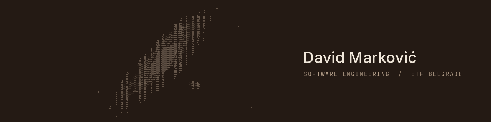

Software engineering student at the University of Belgrade School of Electrical
Engineering (ETF), final year. I work at the boundary between machine learning
and the systems that run it — and at the other boundary, where a model has to
move something physical.

### Selected work

**[Action-conditioned video world model](https://github.com/Dawidzard/PSIML)** · PSIML 2026
Teaching a pretrained 1.3B video diffusion backbone to obey a commanded robot
action, through a rank-16 LoRA and an action encoder on BAIR robot pushing.
99.6% relative direction accuracy on a held-out 256-scene split; the action
signal is worth +5.29 dB PSNR against a null-action control. The free-rollout
section is the interesting one — the first reading of it was wrong.

**[Galaxy Zoo 2 morphology classifier](https://github.com/Dawidzard/galaxy-cnn)** · Neural Networks coursework
239,029 images into barred spiral, elliptical and spiral. 75.10% validation
accuracy, 73.62% macro F1. Barred is the weakest class, and the reason is the
96×96 input rather than the model.

Also, not public: an assembler, linker and CPU emulator; a RISC-V kernel with
preemptive threads, semaphores and a coalescing allocator; a KVM-based virtual
machine monitor.

### Currently studying

GPU architecture, CUDA and Triton, MLIR and LLVM, inference optimisation.
Reinforcement learning, model-based planning and learned world models.
In progress, not claimed as expertise.

### Elsewhere

Amateur astronomy with a 200/1200 Dobsonian — the banner above is my own frame
of M31, redrawn in ASCII. Chess, diving, calisthenics, singing, 3D printing.

[YouTube](https://www.youtube.com/@itsZhiwy) ·
[LinkedIn](https://www.linkedin.com/in/david-markovic-3a107a309/)
